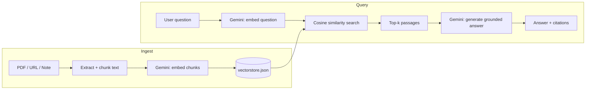

# MultiSourceRAG


A small, self-hosted Retrieval-Augmented Generation website. Add PDFs, web
pages, or pasted notes; ask questions; get answers grounded in — and
cited back to — your own sources. Powered entirely by the **Gemini API**.

## Features

- **Multi-source ingestion** — PDFs, live web pages, and pasted notes all
  feed the same index
- **Grounded, cited answers** — every answer references the exact source
  passages it drew from, shown as hoverable citation chips
- **No external vector database** — cosine-similarity search over a flat
  JSON file, so there's nothing extra to provision for a demo or small
  personal project
- **Deployable as a real website** — ships with a `Dockerfile` and
  `railway.toml` for a one-command deploy to Railway

## Architecture



## Tech stack

| Layer          | Choice                                      |
|----------------|----------------------------------------------|
| Backend        | Node.js, Express                             |
| Embeddings     | Gemini `gemini-embedding-001`                |
| Generation     | Gemini `gemini-flash-latest`                 |
| Retrieval      | Cosine similarity over a JSON-backed store   |
| Ingestion      | `pdf-parse`, `cheerio` (web scraping)        |
| Frontend       | Vanilla HTML/CSS/JS, no build step           |
| Deployment     | Docker + Railway                             |

- **Embeddings:** `gemini-embedding-001`
- **Generation:** `gemini-flash-latest` (currently resolves to Gemini 3.5 Flash)
- **Vector store:** a small JSON file on disk (`data/vectorstore.json`) with
  cosine-similarity search — no external database required
- **Ingestion:** PDF text extraction, web page scraping, or plain text notes

## 1. Get a Gemini API key

Go to [Google AI Studio](https://aistudio.google.com/apikey) and create a
free API key.

## 2. Install and configure

```bash
npm install
cp .env.example .env
```

Open `.env` and paste your key in:

```
GEMINI_API_KEY=your_actual_key_here
```

The other two variables (`GEMINI_EMBEDDING_MODEL`, `GEMINI_GENERATION_MODEL`)
are safe to leave as-is. If Google renames or retires a model later, just
change these — nothing else in the code needs to change.

## 3. Run it

```bash
npm start
```

Then open **http://localhost:3000**.

For auto-restart on file changes during development:

```bash
npm run dev
```

## How it works

1. **Add a source** — paste a URL, upload a PDF/text file, or paste a note
   in the Library panel. The server extracts the text, splits it into
   ~1200-character overlapping chunks, embeds each chunk with Gemini, and
   stores the vectors in `data/vectorstore.json`.
2. **Ask a question** — the server embeds your question (using Gemini's
   `RETRIEVAL_QUERY` task type, which is tuned differently from document
   embeddings), finds the 6 most similar chunks by cosine similarity across
   *all* your sources, and asks Gemini to answer using only those passages.
3. **Citations** — the answer references passages as `[1]`, `[2]`, etc.,
   and each is shown as a small chip you can hover over to see the
   underlying snippet and which source it came from.

## Project layout

```
server.js              Express app + all API routes
src/ingest.js           PDF/URL text extraction + chunking
src/embeddings.js        Gemini embedding calls
src/vectorstore.js       Cosine-similarity search + JSON persistence
src/generate.js          Gemini generateContent call, grounded in retrieved chunks
public/                  Frontend (plain HTML/CSS/JS, no build step)
data/vectorstore.json    Created automatically — your indexed sources live here
```

## Deploy to Railway (so it's a real website, not just localhost)

This repo already includes a `Dockerfile` and `railway.toml`, so Railway
will build and run it correctly with no extra setup.

**1. Install the CLI and log in**

```bash
npm i -g @railway/cli
railway login
```

**2. From inside this project folder, create and link a Railway project**

```bash
railway init
```

(Pick "Empty Project" and give it a name — e.g. `reading-room`.)

**3. Add a persistent volume for your indexed sources**

Without this, `data/vectorstore.json` — everything you've indexed — is
wiped every time you redeploy. In the Railway dashboard: open your
service → **Volumes** → **New Volume** → mount path `/app/data`.
(You can also do this with `railway volume add` on newer CLI versions.)

**4. Set your API key**

```bash
railway variables set GEMINI_API_KEY=your_actual_key_here
```

**5. Deploy**

```bash
railway up
```

**6. Get a public URL**

```bash
railway domain
```

This generates a `*.up.railway.app` URL — that's your live website.
Every subsequent `railway up` redeploys it; because of the volume from
step 3, your indexed sources survive the redeploy.

**Redeploying after code changes:** just run `railway up` again from this
folder. Railway rebuilds the Docker image and restarts the service.

## Notes and limitations

- The vector store is a flat JSON file, which is fine for a personal
  project or demo with up to a few thousand chunks. For heavier use, swap
  `src/vectorstore.js` for a real vector database (e.g. pgvector,
  Pinecone, Qdrant) — the rest of the app doesn't need to change.
- Web-page ingestion does a basic HTML-to-text extraction; sites that
  render content client-side with JavaScript won't extract well.
- There's no authentication — anyone who can reach the server can add
  sources and query them. Put it behind your own auth/proxy before
  exposing it publicly.
- Uploaded files are read into memory and embedded immediately; they
  aren't stored on disk after ingestion (only their extracted, chunked
  text is, inside `vectorstore.json`).

## License

MIT — see [LICENSE](./LICENSE).
